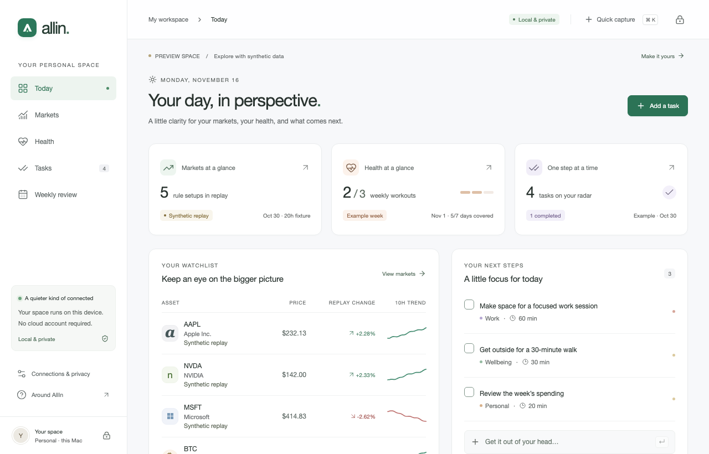
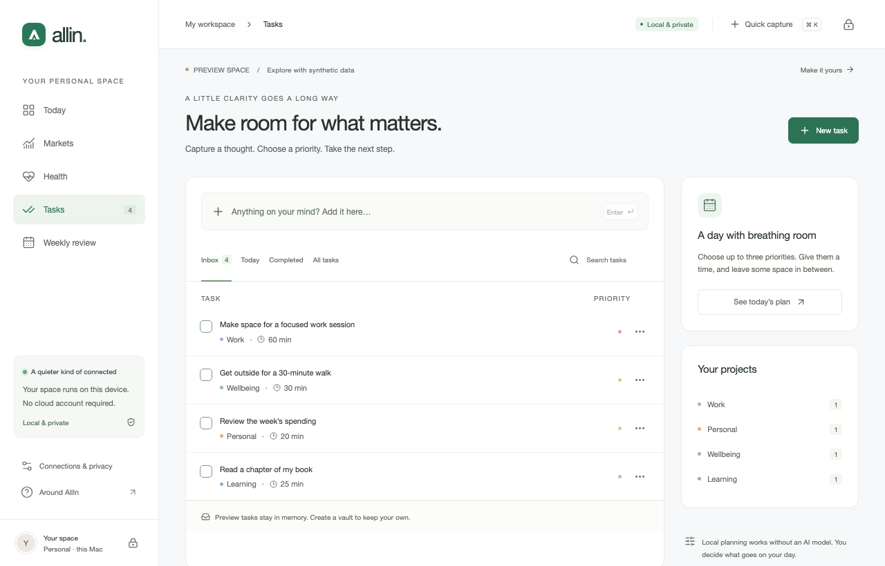

# AllIn

A private dashboard for one person: your tasks, your health summaries and a market watch, on a machine you own. No cloud account, and no network traffic until you turn on a market feed.



|                                              |                                          |                                            |
| -------------------------------------------- | ---------------------------------------- | ------------------------------------------ |
|  |  |  |

The screenshots show the built-in preview. Everything in them is synthetic.

## What it does

- **Tasks:** quick capture, projects, priorities, recurrence, a daily schedule and a weekly review.
- **Health:** daily workout counts and weight, imported from an [OpenFit](https://github.com/Vitzso/open-fit) export file you choose.
- **Markets:** a 20/50 EMA rule watch over five symbols, on synthetic replay data by default, with optional live prices from Coinbase and Alpaca.

AllIn is a small web server that you run yourself and open in your browser. Your data lives in an encrypted vault on that machine.

## Status

AllIn is early, and it was built for one person's own use. This table says what has actually been run, not what is hoped.

| Platform       | Status                                                                                                                                                                             | How to install                                   |
| -------------- | ---------------------------------------------------------------------------------------------------------------------------------------------------------------------------------- | ------------------------------------------------ |
| macOS          | Verified on Apple Silicon, running from source                                                                                                                                     | [Try it on a Mac](#try-it-on-a-mac)              |
| Linux, systemd | Written and tested on a Mac only. Not run on a real Linux machine                                                                                                                  | [docs/INSTALL_LINUX.md](docs/INSTALL_LINUX.md)   |
| Linux, Docker  | Built and started once, on one box, with WireGuard in a container. No vault has been created and nobody has signed in there. The default setup has never run. Live feeds don't run | [docs/INSTALL_DOCKER.md](docs/INSTALL_DOCKER.md) |
| Windows        | Not started                                                                                                                                                                        |                                                  |
| Android        | Not started. AllIn is a server, so an Android app would be a way to open a server you already run                                                                                  |                                                  |

There are no downloadable installers yet. Every install today builds from this source and downloads its dependencies from the npm registry.

## Try it on a Mac

You need Node 22.18 or later. The verified setup is Node 26.13 on Apple Silicon.

```sh
npm ci
npm run build
npm start
```

Open **http://127.0.0.1:4310**. Use that exact address, not `localhost`. The preview opens without an account and shows synthetic data. Choose **Make it yours** to create an empty vault with your own passphrase. Stop the server with Ctrl+C.

## How your data is protected

- A passphrase and a device secret (the macOS Keychain, or a key file on Linux) protect a random master key. That key encrypts three separate SQLite databases, one each for tasks, health and markets.
- The server checks the Host and Origin of every request. A session needs both a cookie and a per-tab token, and it locks after 15 minutes idle.
- Wrong passphrases are rate limited, and the wait survives a restart.
- Backups are encrypted with a separate recovery phrase.
- **There is no reset.** If you lose your passphrase and have no backup with its recovery phrase, the data is gone.

The full picture, including what AllIn does not defend against, is in [docs/THREAT_MODEL.md](docs/THREAT_MODEL.md).

## What it does not do

- **No advice and no trading.** Market setups are rule output for information only, not financial advice. AllIn never places an order. The Alpaca feed needs an Alpaca key, and AllIn asks for a paper-trading one, which can't touch real money. Nothing stops you entering another kind, so don't.
- **No network by default.** AllIn makes no outbound request until you turn on a feed, and then it contacts only `api.coinbase.com` and `data.alpaca.markets`.
- **No telemetry, no update check, no account.**
- **No AI model.** "Plan my day" opens manual scheduling.

## Not verified yet

- The Linux systemd install and its sandbox for the feed worker have never run on Linux.
- The Docker install has built and started once, in one of its two setups. Nobody has created a vault or signed in through it yet.
- The Alpaca feed has only run against Alpaca's documented format, never on real data.
- Nobody has read Coinbase's or Alpaca's terms of service for this project. Read them yourself before relying on a feed.
- This is not a security audit. The tests are evidence for the foundation, not proof.

[docs/DEVELOPMENT.md](docs/DEVELOPMENT.md) has the complete list, with the detail behind each point.

## More

- [docs/DEVELOPMENT.md](docs/DEVELOPMENT.md): everything in detail, including development commands, live feeds, backups and the checks.
- [PROJECT_SPEC.md](PROJECT_SPEC.md): what the project set out to build.
- [docs/IMPLEMENTATION.md](docs/IMPLEMENTATION.md): decisions, data flows and milestone status.
- [CONTRIBUTING.md](CONTRIBUTING.md) and [SECURITY.md](SECURITY.md): how to send a change, and how to report a security problem privately.

## Licence

Apache License 2.0. See [LICENSE](LICENSE) and [NOTICE](NOTICE).
