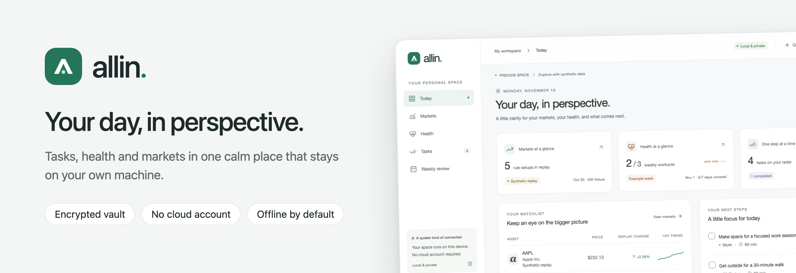
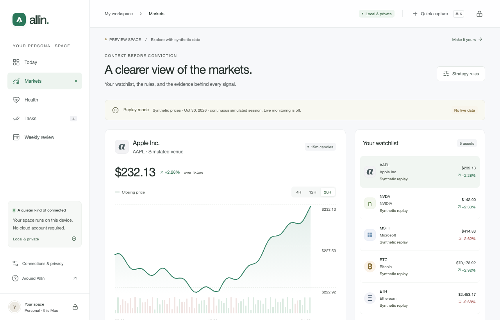
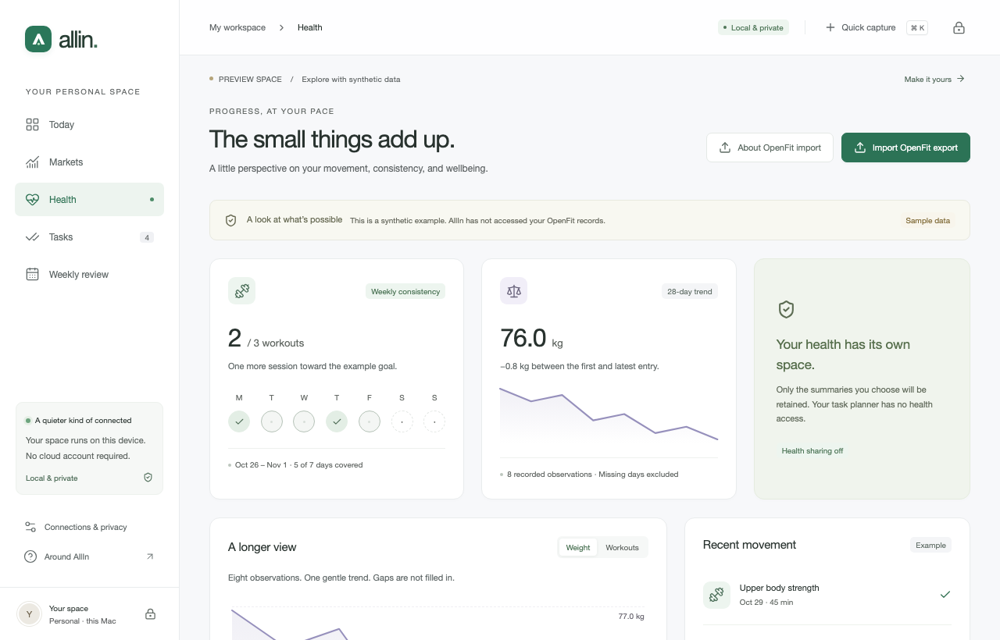

<picture>
  <source media="(prefers-color-scheme: dark)" srcset="docs/images/banner-dark.png">
  
</picture>

# AllIn

I wanted one quiet page that shows what I need to do today, how my week of training is going, and what the handful of markets I follow are doing, without handing any of it to someone else's server. AllIn is that page.

It is a small web app you run yourself. You open it in your browser, your data sits in an encrypted vault on your own machine, and it doesn't talk to the internet unless you switch on a price feed.

<p align="center">
  
  
  
</p>

<p align="center"><sub>Every screenshot shows the built-in preview. All of the data in them is made up.</sub></p>

## What's in it

**Tasks.** Capture a thought with ⌘K, sort it into a project, give it a day and an estimate, and let recurring things come back on their own. A weekly review compares what you planned with what you did.

**Health.** If you log workouts in [OpenFit](https://github.com/Vitzso/open-fit), you can import an export file. AllIn keeps only two numbers per day, workouts counted and weight, and nothing else from the file.

**Markets.** A watchlist of five symbols with a simple 20/50 EMA rule, shown with the evidence behind each signal. It runs on made-up replay prices until you turn on live prices from Coinbase or Alpaca.

## Try it

You need a Mac and Node 22.18 or later. The verified setup is Node 26.13 on Apple Silicon.

```sh
npm ci
npm run build
npm start
```

Then open **http://127.0.0.1:4310**. Use that exact address, not `localhost`.

You land in a preview filled with made-up data, so you can look around before deciding anything. When you want your own space, choose **Make it yours** and pick a passphrase. Ctrl+C stops it.

## Where it runs

AllIn is early, and I built it for my own use first. This is what has actually been run, not what I hope works.

| Platform       | Where it stands                                                                                                                                                                    | Guide                                            |
| -------------- | ---------------------------------------------------------------------------------------------------------------------------------------------------------------------------------- | ------------------------------------------------ |
| macOS          | Verified on Apple Silicon, running from source                                                                                                                                     | [Try it](#try-it)                                |
| Linux, systemd | Written and tested on a Mac only. Not run on a real Linux machine                                                                                                                  | [docs/INSTALL_LINUX.md](docs/INSTALL_LINUX.md)   |
| Linux, Docker  | Built and started once, on one box, with WireGuard in a container. No vault has been created and nobody has signed in there. The default setup has never run. Live feeds don't run | [docs/INSTALL_DOCKER.md](docs/INSTALL_DOCKER.md) |
| Windows        | Not started                                                                                                                                                                        |                                                  |
| Android        | Not started. AllIn is a server, so an Android app would be a way to open a server you already run                                                                                  |                                                  |

There are no installers to download yet. Every install builds from this source and fetches its dependencies from the npm registry.

## Your data

Your passphrase and a secret kept on the device (the macOS Keychain, or a key file on Linux) together unlock a random master key. That key encrypts three separate databases, one each for tasks, health and markets, so each area is kept apart from the others.

The app only answers the exact address it was started on, a signed-in tab needs both a cookie and its own token, and it locks itself after 15 minutes without use. Wrong passphrases make you wait longer each time, and restarting doesn't reset the wait. Backups are encrypted with a separate recovery phrase.

There is no reset. If you lose your passphrase and have no backup with its recovery phrase, the data is gone. That is deliberate.

The longer version, including what AllIn does not protect you from, is in [docs/THREAT_MODEL.md](docs/THREAT_MODEL.md).

## What it won't do

- Give advice or trade. Market signals are rule output for information only, not financial advice. AllIn never places an order. The Alpaca feed needs an Alpaca key, and AllIn asks for a paper-trading one, which can't touch real money. Nothing stops you entering another kind, so don't.
- Phone home. AllIn makes no outbound request until you turn on a feed, and then it contacts only `api.coinbase.com` and `data.alpaca.markets`. There is no telemetry, no update check and no account.
- Pretend to be smart. There is no AI model in it. "Plan my day" opens a schedule you fill in yourself.

## Honest limits

- The Linux systemd install and its sandbox for the feed worker have never run on a real Linux machine.
- The Docker install has built and started once, in one of its two setups. Nobody has created a vault or signed in through it yet.
- The Alpaca feed has only run against Alpaca's documented format, never on real data.
- Nobody has read Coinbase's or Alpaca's terms of service for this project. Read them yourself before relying on a feed.
- This has not had a security audit. The tests are evidence, not proof.

[docs/DEVELOPMENT.md](docs/DEVELOPMENT.md) has the complete list and the detail behind each point.

## Going deeper

- [docs/DEVELOPMENT.md](docs/DEVELOPMENT.md) covers everything in detail: development commands, live feeds, backups and the checks.
- [PROJECT_SPEC.md](PROJECT_SPEC.md) is what the project set out to build, and [docs/IMPLEMENTATION.md](docs/IMPLEMENTATION.md) records the decisions made along the way.
- [CONTRIBUTING.md](CONTRIBUTING.md) explains how to send a change. To report a security problem privately, see [SECURITY.md](SECURITY.md).

## Licence

Apache License 2.0. See [LICENSE](LICENSE) and [NOTICE](NOTICE).
